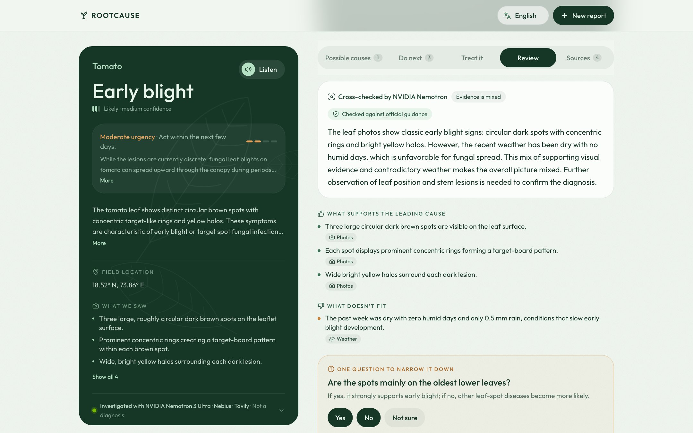
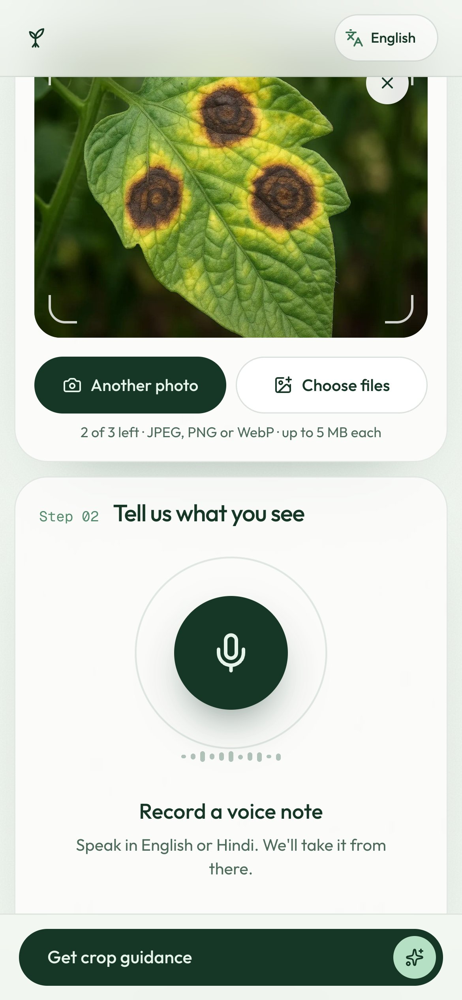
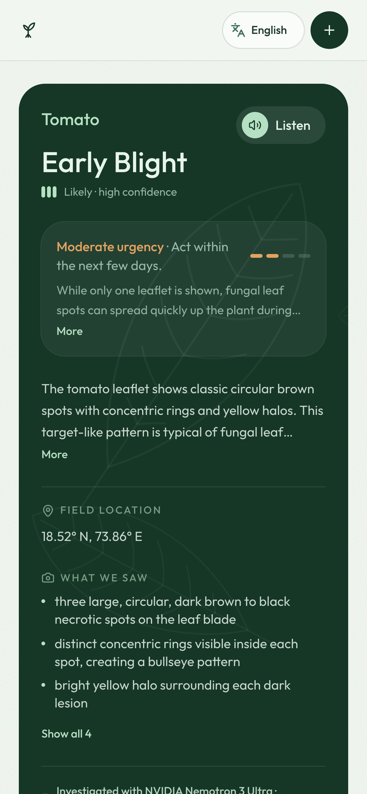
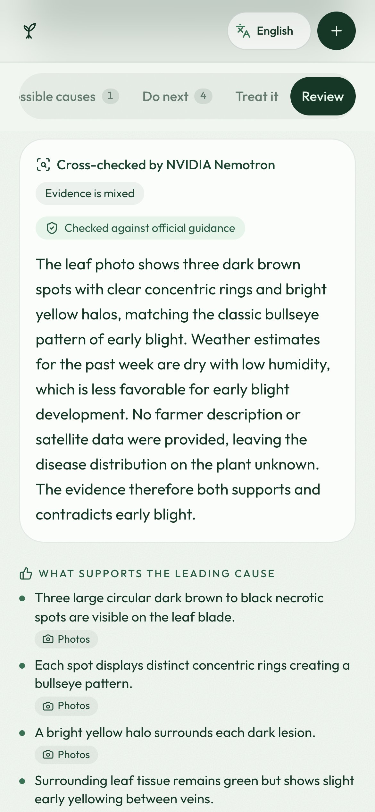
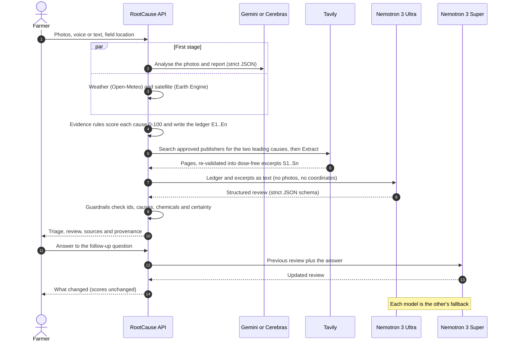
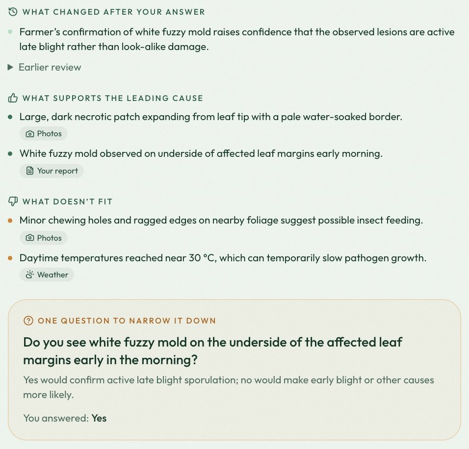
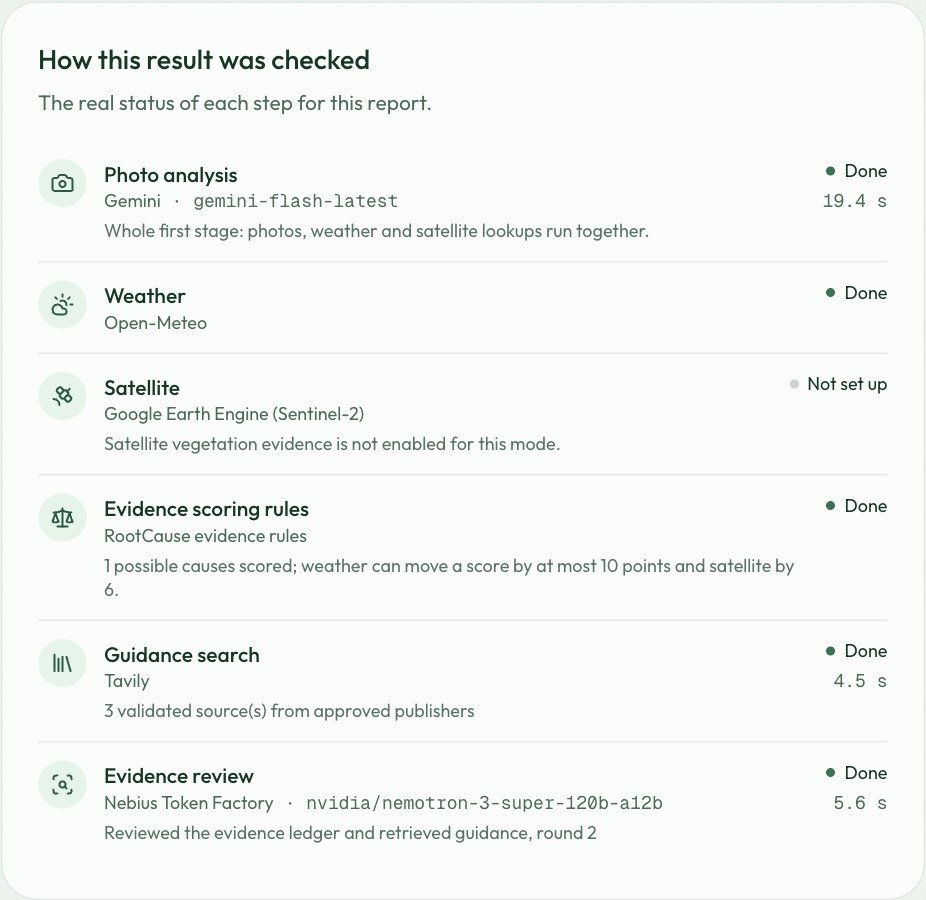
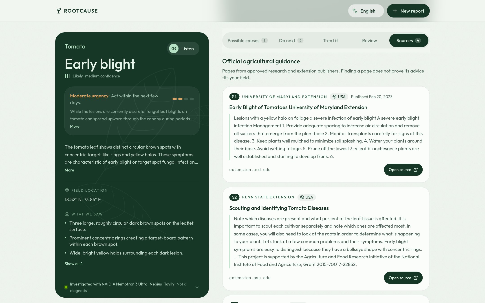
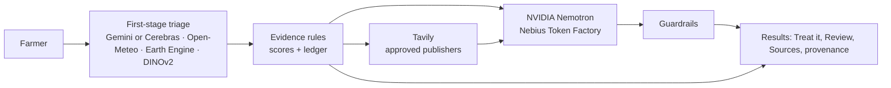

# RootCause: Evidence-Driven Agricultural Investigation with NVIDIA Nemotron, Nebius Token Factory, and Tavily

[](#how-rootcause-uses-nvidia-nemotron-and-nebius-token-factory)
[](#how-rootcause-uses-nvidia-nemotron-and-nebius-token-factory)
[](#how-rootcause-uses-tavily)
[](https://rootcause-web-980426741953.asia-south1.run.app)
[](LICENSE)

A farmer photographs a sick plant and says what is wrong. RootCause gathers the evidence, scores
every possible cause with transparent rules, then **investigates**: Tavily finds guidance from
approved agricultural publishers, **NVIDIA Nemotron 3 Ultra on Nebius Token Factory**
cross-examines all of it, and the farmer answers the one question that best separates the likely
causes. It works in English, Hindi, Punjabi, Spanish and French. It is **triage, never a
diagnosis**: observations, hypotheses, missing evidence and recommendations stay separate, and it
says when to get expert help.

**[Try the live demo](https://rootcause-web-980426741953.asia-south1.run.app)** ·
Demo video: _link added at submission_ ·
[Live health check](https://rootcause-api-980426741953.asia-south1.run.app/api/v1/health) ·
[How to verify the integrations](docs/nebius-hackathon-2026.md#how-judges-can-verify-the-integrations)



<sub>A live result from the deployed app (tomato sample, 28 October 2026). Nemotron 3 Ultra finds
that the photos support early blight but the dry week argues against it, calls the evidence mixed,
and asks one question to tell the causes apart.</sub>

> **Hackathon edition (repository `RootCause-Hackathon`)**, submitted to the **Nebius x NVIDIA
> Global AI Hackathon** (Best Apps and Agents track; also for Best Use of Tavily). The first
> version of RootCause (photo triage, weather and satellite evidence, scoring, voice and *Treat
> it*) was built from 14 to 17 October 2026. This edition adds a second-stage *investigation*:
> **Tavily** retrieves guidance from approved agricultural publishers, and **NVIDIA Nemotron 3
> Ultra and Nemotron 3 Super on Nebius Token Factory** cross-examine the evidence. Timeline and
> verification guide: [docs/nebius-hackathon-2026.md](docs/nebius-hackathon-2026.md).

**Evidence first. Models reason. Rules protect. Sources substantiate. Farmers decide.**

[Try it](#try-it-in-two-minutes) · [The problem](#the-problem) ·
[How it works](#how-the-investigation-works) ·
[Nemotron and Nebius](#how-rootcause-uses-nvidia-nemotron-and-nebius-token-factory) ·
[Tavily](#how-rootcause-uses-tavily) · [Guardrails](#guardrails) ·
[For judges](#for-judges-the-criteria-at-a-glance) · [Run it locally](#setup) ·
[Limitations](#safety-and-known-limitations)

## Try it in two minutes

1. Open the **[live demo](https://rootcause-web-980426741953.asia-south1.run.app)** on a phone or
   laptop and tap **Start a crop report**.
2. Tap the **Tomato** or **Potato** sample photo, or add your own. Share your location, or open
   *Add where the field is* and type a village or district, so recent weather is included. Tap
   **Get crop guidance**: the whole investigation takes about 40 seconds.
3. On the result, open **Review** (Nemotron's cross-examination) and **Sources** (the validated
   publisher pages Tavily found). Answer the **one question** in the review: Nemotron 3 Super
   re-reviews and shows *What changed after your answer*.
4. Scroll to **How this result was checked**: every provider that ran, with its model, real
   status and duration.
5. Open [`/api/v1/health`](https://rootcause-api-980426741953.asia-south1.run.app/api/v1/health):
   it shows `investigation_review: "configured"`, the Nemotron model and
   `investigation_strict: true`.

The hosted demo runs without the optional satellite and reference-photo steps; they show as
*Not set up*. Each browser session can run 5 investigations. After a quiet spell, the first
request takes a few seconds longer while Cloud Run starts.

## The problem

One photo of a spotted leaf rarely tells the whole story. Early blight, late blight, a nutrient
problem and water stress can look alike. Recent weather, field greenness and published guidance
help tell them apart, but farmers seldom have all of that in one place, and generic chatbot answers
can sound certain while being wrong, or recommend chemicals that are not approved locally.

The stakes are real: FAO estimates that pests and diseases destroy
[20 to 40 percent of global crop production every year](https://www.fao.org/newsroom/detail/New-standards-to-curb-the-global-spread-of-plant-pests-and-diseases/en).
For a smallholder, a wrong guess costs twice: the crop keeps declining, and money goes on a spray
that never fit the problem.

Intended users: smallholder farmers, and the extension workers and Krishi Vigyan Kendra (KVK)
staff who support them.

## What it does

1. **Report.** Photo first: up to three photos, or a built-in **sample** (chilli, potato,
   tomato). The crop is identified from the photo; the farmer is asked only when the model is
   unsure. An optional voice note (English or Hindi, language auto-detected) or typed
   description, plus the field's location after an explain-first prompt.
2. **First-stage triage** (first version). Gemini reads the photos and the farmer's words into
   observations, possible causes and actions; recent weather (Open-Meteo), Sentinel-2 vegetation
   indices (Google Earth Engine) and similar labelled reference photos (DINOv2 + FAISS) are
   gathered; deterministic rules turn them into a 0–100 evidence-fit score per cause, with every
   adjustment recorded in an evidence ledger.
3. **Investigation** (new). Tavily searches only approved research and extension publishers for
   the leading causes; Nemotron reviews the ledger and the validated excerpts, names what
   supports and contradicts the leading cause, what is still uncertain, the single most useful
   field check, and safe, non-chemical next steps. Deterministic guardrails then remove anything
   that cites unknown evidence or sources, promotes an unlisted cause, gives chemical doses or
   sounds more certain than the evidence.
4. **Results.** Summary card with **Listen** (read aloud in the result's language), field
   conditions, and tabs for *Possible causes*, *Do next*, *Treat it* (first version: non-chemical
   steps first, generic active ingredients only, and nearby agri-input shops), *Review* and
   *Sources* (official guidance cards with links), plus **How this result was checked**: every
   provider and its real status for this report.
5. **Follow-up** (new). The farmer answers Nemotron's yes / no / not-sure question; the answer is
   recorded as evidence and the review is redone, without changing any score.

Fair use: 5 investigations per browser session (enforced by the API too) with a friendly limit
screen, and per-client hourly caps on every model-backed endpoint.

<p align="center">
  
  
  
</p>

## How the investigation works

RootCause runs a bounded investigation agent. The backend gathers and scores the evidence and
enforces the rules, Nemotron does the reasoning, and the farmer closes the loop.



- **It collects evidence before it reasons.** Photo analysis, recent weather and, when configured,
  Sentinel-2 indices run in parallel; deterministic rules turn them into scores and an evidence
  ledger, so every point added or removed has a recorded reason.
- **It decides what to research.** The backend searches approved publishers for the two leading
  causes in parallel, retries worldwide when a country-specific search comes back empty, and uses
  Extract for deeper text while time allows.
- **It argues with the evidence.** Nemotron 3 Ultra lists what supports the leading cause, what
  contradicts it and what is still unknown, citing only backend-issued evidence and source ids.
- **It asks for what is missing.** Nemotron picks one yes/no question that separates the two
  leading causes. The farmer's answer becomes new evidence, and Nemotron 3 Super redoes the
  review.
- **It knows its limits.** The investigation has a 55-second budget, every step reports its real
  status, and if Nemotron fails the triage still arrives and says so.

<p align="center">
  
</p>
<p align="center"><sub>Potato sample, live: the farmer answered “Yes” to Nemotron's question, and
Nemotron 3 Super explains what changed. The scores stay the same.</sub></p>

## Who does what

| Responsibility | Provider | Boundary |
| --- | --- | --- |
| Photo and report analysis; translation | Gemini Flash (priority key, then fallback key), then Qwen 3.8 (27B) on Cerebras | Strict JSON schema; hypotheses only |
| Voice input; read-aloud | Gemini Flash-Lite (language auto-detected; Speech-to-Text V2 fallback); Gemini TTS | Transcript goes into the report; nothing is stored |
| *Treat it* guidance; nearby shops | Gemini; Gemini grounded on Google Maps | Generic active ingredients only, never brands or doses; only places Maps returned |
| Recent weather | Open-Meteo | Model-based regional estimates, not field measurements |
| Vegetation evidence | Google Earth Engine (Sentinel-2 NDVI/NDMI) | Area averages; never a diagnosis |
| Similar labelled photos | DINOv2 + FAISS | Rice, tomato and potato; visual similarity only |
| Scores, ranking, evidence ledger | RootCause evidence rules | Deterministic and authoritative |
| Agricultural guidance discovery | Tavily Search (+ Extract) | Approved publishers only; retrieval is not verification |
| Evidence reconciliation, contradictions, uncertainty, follow-up question, source-grounded next steps | NVIDIA Nemotron 3 Ultra (`nvidia/Nemotron-3-Ultra-550b-a55b`) for the review, Nemotron 3 Super (`nvidia/nemotron-3-super-120b-a12b`) for follow-up re-reviews, via Nebius Token Factory | Text only: no photos, no coordinates; cannot change scores, ranking or urgency |
| Safety enforcement | RootCause guardrails | Backend-issued ids, citation checks, chemical and certainty filters |

If Nemotron is unavailable the triage is returned unchanged with an explicit status; the review
is never replaced by Gemini, another model or a mock.

## How RootCause uses NVIDIA Nemotron and Nebius Token Factory

Nemotron runs on every real report, through Nebius Token Factory's OpenAI-compatible Chat
Completions endpoint (plain `httpx`, no SDK). Two models are routed by job:

| Job | Model on Nebius Token Factory | Why this model | Live run, 28 Oct 2026 |
| --- | --- | --- | --- |
| Evidence review | `nvidia/Nemotron-3-Ultra-550b-a55b` | Serious reasoning: reconcile photos, weather, scores and sources, and find the contradictions | 8.7 s |
| Follow-up re-review | `nvidia/nemotron-3-super-120b-a12b` | A fast update after one farmer answer keeps the app responsive | 5.6 s |
| Fallback | Each model for the other | Any failure except a rejected key, while at least 10 s of the budget remain | n/a |

- **Structured, checked output.** Requests use strict JSON-schema output
  (`response_format: json_schema`) and the low-effort reasoning switch (`chat_template_kwargs`).
  The reply is validated with Pydantic, repaired once if needed, then passed through
  deterministic [guardrails](#guardrails) before anyone sees it.
- **A compact, citable payload.** Nemotron receives the scored evidence ledger and the validated
  excerpts as text with backend-issued ids (E1, E2… and S1, S2…), never the photos or the field's
  coordinates. Farmer text and retrieved pages are passed as untrusted evidence, never as
  instructions.
- **Visible in every result.** *How this result was checked* shows the provider, exact model,
  status and duration of each Nemotron call, and `/api/v1/health` shows the configured model.

**Where Token Factory accelerated the build**

- One OpenAI-compatible endpoint and one key cover every Nemotron size, so comparing Ultra, Super
  and Nano for this task was a model-id change. All three returned schema-valid reviews in our
  live check.
- Strict `json_schema` output and the reasoning switch were accepted as they are, so there is no
  output-parsing layer to maintain.
- Because both models sit behind the same API, routing by job and mutual fallback took a few
  lines of code (`FallbackNebiusClient` in
  [apps/api/app/integrations/nebius.py](apps/api/app/integrations/nebius.py)).
- The `/v1/models` catalog lets the smoke test confirm the model ids before the app relies on
  them.

| Round 1: Nemotron 3 Ultra reviews the evidence | Round 2: Nemotron 3 Super after the farmer's answer |
| --- | --- |
|  |  |

## How RootCause uses Tavily

Tavily is RootCause's evidence finder, not its authority. It runs in the same request as the
review, whenever the report names a specific crop and cause:

- **Search, scoped to trusted publishers.** For the two leading causes, the backend builds each
  query from the crop and condition only (never the farmer's words, photos or coordinates) and
  calls Tavily Search with `include_domains` set to 30 approved research and extension
  publishers: ICAR and its institutes, TNAU, PAU and India's agriculture ministry and
  plant-protection directorate; FAO, CABI, IRRI, CIP, CIMMYT and the World Vegetable Center; US
  land-grant extension services; AHDB, Teagasc, three Australian state departments and KALRO.
  Both searches run in parallel.
- **Country-aware, with a fallback.** A coarse country hint favours local publishers. When the
  hinted search returns nothing (we found this for India), it retries worldwide, still inside the
  allowlist.
- **Extract for depth.** When at least 4 seconds remain, Tavily Extract pulls query-ranked text
  from the top two pages and replaces short snippets with richer excerpts.
- **Re-validated before use.** Every result is checked again: an approved domain on a dot
  boundary (`evil-fao.org` does not match `fao.org`), both the crop and the condition mentioned,
  not an instruction page, and enough relevant text. Dose sentences and site chrome (cookie
  notices, breadcrumbs) are stripped from excerpts.
- **Grounding the review.** Validated pages become sources S1, S2…; Nemotron can cite only those
  ids, and each of its claims is labelled *source-backed* or *unverified*. Farmers see the pages
  in the **Sources** tab, with a link to the publisher.
- **Bounded cost.** Results are cached for 6 hours per crop, causes and country, and Tavily
  credits are counted per report.



## Guardrails

Nemotron can explain and question the triage, but deterministic code decides what reaches the
farmer ([guardrails.py](apps/api/app/services/investigation/guardrails.py)):

| If the model… | RootCause… |
| --- | --- |
| cites evidence or a source that was not supplied | drops it; only backend-issued ids are accepted |
| promotes a cause that was not scored | drops it |
| treats missing data as evidence | drops it |
| names a pesticide brand, dose or spray schedule | removes it and adds a referral to the local extension office or KVK |
| sounds more certain than the evidence allows | removes the sentence |
| would change scores, ranking or urgency | cannot: the review sits beside the deterministic triage and never edits it |
| fails, times out or returns invalid JSON | returns the triage with an explicit status; the review is never replaced by another model or a mock |

The expert-review flag can be raised but never lowered, and the review shows how many items the
guardrails removed.

## Architecture



Details: [docs/architecture.md](docs/architecture.md) · contract: [docs/api-contract.md](docs/api-contract.md).

## For judges: the criteria at a glance

| Criterion | Where RootCause shows it |
| --- | --- |
| **Technological implementation** | Two Nemotron models on Token Factory, routed by job with mutual fallback inside a 55-second budget; strict JSON-schema output, validation, one repair and deterministic guardrails; Tavily Search and Extract with independent validation and caching; 390 API tests and 55 web tests; live on Cloud Run with keys in Secret Manager |
| **Design** | One coherent flow built for phones: photo first with one-tap samples, a voice note in English or Hindi, an explain-first location prompt, results in five languages with read-aloud. The review lives inside the result (Review and Sources tabs, a follow-up card), not in a chat window, and every step shows its real status |
| **Potential impact** | Built for smallholders and the extension and KVK staff who support them, where pests and diseases cost 20–40% of crop production. It replaces guesswork with evidence and the one field check that matters, cites approved publishers, never invents doses and says when to call an expert |
| **Quality of the idea** | Nemotron is a cross-examiner, not an oracle: it argues with deterministic evidence, cites only backend-issued ids, cannot change scores, and asks the single question that separates the leading causes. Retrieval is treated as discovery, not verification |

## Engineering quality

- **Tests:** 390 API tests (pytest) and 55 web tests (Vitest) cover the guardrails,
  orchestration, Tavily validation, model fallback, follow-up and rate limits with HTTP mocked.
  Live tests against the real APIs are opt-in.
- **CI on every push and pull request:** ruff, ruff format, mypy and pytest for the API; ESLint,
  TypeScript, Vitest and a production build for the web app.
- **Strict mode in production:** a missing Nemotron setup is reported as `misconfigured` in
  `/api/v1/health`, and mock output is never presented as a real model call.
- **Bounded cost and abuse:** 5 investigations per browser session, per-client hourly caps on
  every model-backed endpoint, a daily review cap, and client IPs read from the address the proxy
  appends, so they cannot be spoofed.
- **Secrets stay server-side:** keys live in Secret Manager; the browser only talks to the API.

## Repository layout

```text
apps/
  web/     Next.js 16 (App Router, TypeScript strict, Tailwind v4)
  api/     FastAPI (Python 3.12, Pydantic v2, pytest)
deploy/    Cloud Build config and Cloud Run guide
docs/      architecture, API contract, hackathon timeline, demo script, roadmap, decisions
.github/   CI workflow and PR template
```

## Prerequisites

- Node.js 20.9+ (CI uses 22) and npm
- Python 3.12+

## Setup

```bash
git clone https://github.com/jayeshrajani/RootCause-Hackathon.git && cd RootCause-Hackathon
cp .env.example .env            # then add keys; never commit .env
```

Keys go in the repo-root `.env`. All are optional: without them the API still runs and reports
each missing piece explicitly.

| Variable | Enables | Without it |
| --- | --- | --- |
| `GEMINI_API_KEY_PRIORITY` (or `GEMINI_API_KEY`) | Photo analysis, translation, voice input, read-aloud, *Treat it* and shop search | Cerebras analysis if its key is set (no voice, read-aloud or *Treat it*); otherwise labelled mock results |
| `GEMINI_API_KEY_FALLBACK` | A second Gemini key, used when calls on the first fail | Only the priority key is used |
| `CEREBRAS_API_KEY` | Analysis fallback when Gemini is unavailable | No fallback |
| `NEBIUS_API_KEY` | NVIDIA Nemotron evidence review ([tokenfactory.nebius.com](https://tokenfactory.nebius.com)) | Review shown as "not set up" |
| `TAVILY_API_KEY` | Agricultural guidance search ([app.tavily.com](https://app.tavily.com)) | Review runs on internal evidence only |
| `GOOGLE_CLOUD_PROJECT_ID` | Satellite evidence and the Speech-to-Text voice fallback (log in with `gcloud auth application-default login`) | Satellite reported as unavailable |

Every other setting (models, timeouts, limits, strict mode) is documented in
[.env.example](.env.example).

### API (terminal 1)

```bash
cd apps/api
python3.12 -m venv .venv
source .venv/bin/activate
pip install -e ".[dev]"
uvicorn app.main:app --reload --port 8000
```

- Health: <http://localhost:8000/api/v1/health>
- Interactive docs: <http://localhost:8000/docs>

### Web (terminal 2)

```bash
cd apps/web
npm install
npm run dev
```

Open <http://localhost:3000>, tap **Start a crop report**, add a photo (or a sample) and speak or
tap **Get crop guidance**. With all keys set, the analysis takes up to about a minute.

The web app calls `http://localhost:8000` by default. To change it, create `apps/web/.env.local`
with `NEXT_PUBLIC_API_BASE_URL=...`. If you run the web app on a different port, add that origin
to `ROOTCAUSE_CORS_ORIGINS` in `.env`. Settings are read at startup: restart the API after
editing `.env`. `/api/v1/health` shows which providers are configured.

## Checks (same as CI)

```bash
# apps/api (with the venv active)
ruff check . && ruff format --check . && mypy app tests && pytest

# apps/web
npm run lint && npm run typecheck && npm test && npm run build
```

Live checks against the real Nebius and Tavily APIs (billed; never run in CI):

```bash
# apps/api, keys in .env
python scripts/smoke_live.py all          # Tavily search, then a Nemotron review grounded in it
ROOTCAUSE_RUN_LIVE_TESTS=1 pytest -m live
```

## Deploy

Two Cloud Run services built by Cloud Build, with keys in Secret Manager and strict mode on:
[deploy/README.md](deploy/README.md). The live demo runs in `asia-south1` (Mumbai):

- Web: <https://rootcause-web-980426741953.asia-south1.run.app>
- API health: <https://rootcause-api-980426741953.asia-south1.run.app/api/v1/health>

## Hackathon submission

- **Track:** Best Apps and Agents; also eligible for Best Use of Tavily (RootCause makes runtime
  calls to Tavily Search and Extract).
- **Live demo:** <https://rootcause-web-980426741953.asia-south1.run.app>, without the optional
  satellite and reference-photo steps.
- **Video (under 3 minutes):** _link added at submission_; script in
  [docs/hackathon-demo-script.md](docs/hackathon-demo-script.md).
- **Existing work and what changed:** the first version was built from 14 to 17 October 2026 and
  the investigation stage from 28 October; see the
  [timeline](docs/nebius-hackathon-2026.md#timeline).
- **Live verification:** [what was checked against the real APIs](docs/nebius-hackathon-2026.md#status-implemented-tested-live-verified).

## Challenges and what we learned

- **Retrieval is not verification.** Tavily finds good pages fast, but finding a page does not
  make its advice fit a farmer's field. The allowlist, re-validation and dose stripping are what
  make a page safe to show.
- **Ask the model to disagree, not to answer.** Nemotron was most useful when asked what
  contradicts the leading cause and which single observation would settle it, with the scores
  held fixed by rules.
- **Routing by job keeps a 550B model usable.** Ultra with the low-effort reasoning switch
  finishes the review in seconds, Super handles the quick re-review, and each covers for the
  other.
- **Combined filters can silently return nothing.** `include_domains` with `country="india"`
  returned no results for queries that worked worldwide, so RootCause now retries worldwide.
- **Citations need ids, not trust.** Backend-issued evidence and source ids make invented
  citations easy to detect and drop.
- **Honest failure beats a fake answer.** Every step reports its real status; if Nemotron is
  down, the farmer still gets the triage, labelled as such.

## Documentation

- [Hackathon timeline, verification guide and submission notes](docs/nebius-hackathon-2026.md)
- [Architecture](docs/architecture.md)
- [API contract](docs/api-contract.md)
- [Deployment](deploy/README.md)
- [Reference retrieval (DINOv2 + FAISS)](docs/retrieval.md) and [reference datasets](docs/datasets.md)
- [Roadmap](docs/roadmap.md)
- [Decision records](docs/decisions/)
- [Contributing](CONTRIBUTING.md)

## Safety and known limitations

- Output is triage guidance, not a confirmed diagnosis. Confirm with a local agricultural expert
  before treating crops.
- RootCause never recommends pesticide brands, doses or spray schedules. In the review,
  model-written chemical advice is removed and replaced by a referral to the local extension
  office or KVK, and dose sentences are removed from quoted source excerpts.
- The *Treat it* tab names generic active ingredients from Gemini's knowledge, never brands or
  doses, and always says to follow the label and check with the KVK. It is not a
  registered-product database, and it is not part of the Nemotron review.
- Missing weather, satellite or guidance data is never treated as normal.
- Guidance comes from an allowlist of research and extension publishers worldwide. A page being
  found does not mean its advice fits the farmer's region, variety or crop stage; the
  "source-backed" label is a lexical check that the excerpt discusses the claim, not proof.
- Nemotron sees structured text only. It does not see the photos, so it cannot correct a wrong
  visual reading; it can only point out where the evidence disagrees.
- Follow-up answers are recorded as evidence but do not change scores (no scoring rule exists
  for them yet).
- Usage and rate limits, the daily review cap and follow-up context are kept in memory per API
  instance and reset on restart.
- Reference-photo retrieval is not included in the Cloud Run image (it needs PyTorch and the
  index files).
- Results are not persisted; the latest result stays in the browser tab's `sessionStorage`.
  Photos, voice notes and read-aloud text are processed in memory for the request and never
  stored or logged; location is used only for the weather, satellite and shop lookups.
- Gemini text-to-speech and Maps grounding are billed per request on Gemini's paid tier.
- The interface is fully translated in English and Hindi; other languages fall back to English
  in places. iOS Safari voice recording is untested.
- Requests without a `Content-Length` header skip the early total-size check (each photo is
  still capped individually).

## Roadmap

- Deterministic rules that let a follow-up answer adjust evidence fit, with tests per condition.
- Region-aware source ranking and per-country lists of approved treatments, reviewed by
  extension experts.
- Persistent, consented report history for extension workers.
- Shared rate limits (for example Redis) when scaling beyond a demo.

See [docs/roadmap.md](docs/roadmap.md) for the original milestone plan.

## License and acknowledgements

[MIT](LICENSE). NVIDIA Nemotron models are used through Nebius Token Factory under the NVIDIA
Open Model License. Reference photos come from PlantDoc, PlantVillage and a Mendeley rice dataset
under their CC licences; attribution is in [docs/datasets.md](docs/datasets.md).

## Troubleshooting

- **"Couldn't reach RootCause"** in the form: the API isn't running, is on another port, or CORS
  doesn't allow your web origin.
- **Results say "via Cerebras"**: both Gemini keys are rate-limited or out of quota (HTTP 429);
  enable billing on the Gemini project or wait for the daily reset.
- **Voice says it isn't available**: no Gemini key is set (and no Speech-to-Text project).
- **TLS / certificate errors during `npm install` or `npx shadcn` behind a corporate proxy**: on
  Node 22+ try `NODE_OPTIONS=--use-system-ca` so Node trusts the OS certificate store. The API
  uses the OS trust store for every provider call.
- **Review says "not set up"**: `NEBIUS_API_KEY` is missing; check `/api/v1/health` and restart
  the API after editing `.env`.
- **Review says the request was rejected**: the Nebius endpoint may not accept the reasoning switch
  or JSON schema for the model; try `ROOTCAUSE_NEBIUS_REASONING=default` or
  `ROOTCAUSE_NEBIUS_STRUCTURED_OUTPUT=json_object`, and confirm the model id with
  `python scripts/smoke_live.py nebius`.
