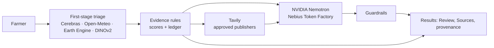

# RootCause: Evidence-Driven Agricultural Investigation with NVIDIA Nemotron, Nebius Token Factory, and Tavily

RootCause helps a farmer work out what may be wrong with a crop from a phone photo and a few
words, in English, Hindi, Punjabi, Spanish or French. It is **triage, never a diagnosis**:
observations, hypotheses, missing evidence and recommendations are always kept separate, and it
says when to get expert help.

> **Hackathon edition (repository `RootCause-Hackathon`).** The first version of RootCause was built from 14 to 17 October 2026. For this hackathon it gained a
> second-stage *investigation*: **Tavily** retrieves guidance from approved agricultural
> publishers, and **NVIDIA Nemotron 3 Super on Nebius Token Factory** cross-examines the evidence.
> Timeline and verification guide: [docs/nebius-hackathon-2026.md](docs/nebius-hackathon-2026.md).

**Evidence first. Models reason. Rules protect. Sources substantiate. Farmers decide.**

## The problem

One photo of a spotted leaf rarely tells the whole story. Early blight, late blight, a nutrient
problem and water stress can look alike. Recent weather, field greenness and published guidance
help tell them apart, but farmers seldom have all of that in one place, and generic chatbot answers
can sound certain while being wrong, or recommend chemicals that are not approved locally.

Intended users: smallholder farmers, and the extension workers and Krishi Vigyan Kendra (KVK)
staff who support them.

## What it does

1. **Report.** Up to three photos, plus optional crop, symptom duration, place or GPS and a
   description (typed or spoken).
2. **First-stage triage** (first version). The photos and the farmer's words are analysed into
   observations, possible causes and actions; recent weather (Open-Meteo), Sentinel-2 vegetation
   indices (Google Earth Engine) and similar labelled reference photos (DINOv2 + FAISS) are
   gathered; deterministic rules turn them into a 0–100 evidence-fit score per cause, with every
   adjustment recorded in an evidence ledger.
3. **Investigation** (new). Tavily searches only approved research and extension publishers for
   the leading causes; Nemotron reviews the ledger and the validated excerpts, names what
   supports and contradicts the leading cause, what is still uncertain, the single most useful
   field check, and safe, non-chemical next steps. Deterministic guardrails then remove anything
   that cites unknown evidence or sources, promotes an unlisted cause, gives chemical doses or
   sounds more certain than the evidence.
4. **Results.** Summary card, field conditions, and tabs for *Possible causes*, *Do next*,
   *Review* and *Sources* (official guidance cards with links), plus **How this result was
   checked**: every provider and its real status for this report.
5. **Follow-up** (new). The farmer answers Nemotron's yes / no / not-sure question; the answer is
   recorded as evidence and the review is redone, without changing any score.

## Who does what

| Responsibility | Provider | Boundary |
| --- | --- | --- |
| Photo and report analysis; translation | Qwen 3.8 (27B) on Cerebras | Strict JSON schema; hypotheses only |
| Recent weather | Open-Meteo | Model-based regional estimates, not field measurements |
| Vegetation evidence | Google Earth Engine (Sentinel-2 NDVI/NDMI) | Area averages; never a diagnosis |
| Similar labelled photos | DINOv2 + FAISS | Rice, tomato and potato; visual similarity only |
| Scores, ranking, evidence ledger | RootCause evidence rules | Deterministic and authoritative |
| Agricultural guidance discovery | Tavily Search (+ Extract) | Approved publishers only; retrieval is not verification |
| Evidence reconciliation, contradictions, uncertainty, follow-up question, source-grounded next steps | NVIDIA Nemotron 3 Super (`nvidia/nemotron-3-super-120b-a12b`) via Nebius Token Factory | Text only: no photos, no coordinates; cannot change scores, ranking or urgency |
| Safety enforcement | RootCause guardrails | Backend-issued ids, citation checks, chemical and certainty filters |

Gemini is not used in this codebase. If Nemotron is unavailable the triage is returned unchanged
with an explicit status; it is never replaced by another model or a mock.

## Architecture



Details: [docs/architecture.md](docs/architecture.md) · contract: [docs/api-contract.md](docs/api-contract.md).

## Repository layout

```text
apps/
  web/     Next.js 16 (App Router, TypeScript strict, Tailwind v4)
  api/     FastAPI (Python 3.12, Pydantic v2, pytest)
deploy/    Cloud Build config and Cloud Run guide
docs/      architecture, API contract, hackathon timeline, demo script, roadmap, decisions
.github/   CI workflow and PR template
```

## Prerequisites

- Node.js 20.9+ (CI uses 22) and npm
- Python 3.12+

## Setup

```bash
git clone <repo-url> rootcause && cd rootcause
cp .env.example .env            # then add keys; never commit .env
```

Keys go in the repo-root `.env`. All are optional: without them the API still runs and reports
each missing piece explicitly.

| Variable | Enables | Without it |
| --- | --- | --- |
| `CEREBRAS_API_KEY` | Photo analysis and translation | Labelled mock results (`analysis_mode: "mock"`) |
| `NEBIUS_API_KEY` | NVIDIA Nemotron evidence review ([tokenfactory.nebius.com](https://tokenfactory.nebius.com)) | Review shown as "not set up" |
| `TAVILY_API_KEY` | Agricultural guidance search ([app.tavily.com](https://app.tavily.com)) | Review runs on internal evidence only |
| `GOOGLE_CLOUD_PROJECT_ID` | Satellite evidence and voice input (log in with `gcloud auth application-default login`) | Satellite and voice reported as unavailable |

Every other setting (models, timeouts, limits, strict mode) is documented in
[.env.example](.env.example).

### API (terminal 1)

```bash
cd apps/api
python3.12 -m venv .venv
source .venv/bin/activate
pip install -e ".[dev]"
uvicorn app.main:app --reload --port 8000
```

- Health: <http://localhost:8000/api/v1/health>
- Interactive docs: <http://localhost:8000/docs>

### Web (terminal 2)

```bash
cd apps/web
npm install
npm run dev
```

Open <http://localhost:3000>, choose **Report a crop problem**, add a photo, and submit. With
all keys set, the analysis takes up to about a minute.

The web app calls `http://localhost:8000` by default. To change it, create `apps/web/.env.local`
with `NEXT_PUBLIC_API_BASE_URL=...`. If you run the web app on a different port, add that origin
to `ROOTCAUSE_CORS_ORIGINS` in `.env`. Settings are read at startup: restart the API after
editing `.env`. `/api/v1/health` shows which providers are configured.

## Checks (same as CI)

```bash
# apps/api (with the venv active)
ruff check . && ruff format --check . && mypy app tests && pytest

# apps/web
npm run lint && npm run typecheck && npm test && npm run build
```

Live checks against the real Nebius and Tavily APIs (billed; never run in CI):

```bash
# apps/api, keys in .env
python scripts/smoke_live.py all          # Tavily search, then a Nemotron review grounded in it
ROOTCAUSE_RUN_LIVE_TESTS=1 pytest -m live
```

## Deploy

Two Cloud Run services built by Cloud Build, with keys in Secret Manager and strict mode on:
[deploy/README.md](deploy/README.md).

## Live demo

- Demo: _URL to be added after deployment_
- Video (under 3 minutes): _to be added_; script in [docs/hackathon-demo-script.md](docs/hackathon-demo-script.md)

## Documentation

- [Hackathon timeline, verification guide and submission notes](docs/nebius-hackathon-2026.md)
- [Architecture](docs/architecture.md)
- [API contract](docs/api-contract.md)
- [Deployment](deploy/README.md)
- [Reference retrieval (DINOv2 + FAISS)](docs/retrieval.md) and [reference datasets](docs/datasets.md)
- [Roadmap](docs/roadmap.md)
- [Decision records](docs/decisions/)
- [Contributing](CONTRIBUTING.md)

## Safety and known limitations

- Output is triage guidance, not a confirmed diagnosis. Confirm with a local agricultural expert
  before treating crops.
- RootCause never recommends pesticide brands, doses or spray schedules. Model-written chemical
  advice is removed and replaced by a referral to the local extension office or KVK; dose
  sentences are removed from quoted source excerpts.
- Missing weather, satellite or guidance data is never treated as normal.
- Guidance comes from an allowlist of research and extension publishers worldwide. A page being
  found does not mean its advice fits the farmer's region, variety or crop stage; the
  "source-backed" label is a lexical check that the excerpt discusses the claim, not proof.
- Nemotron sees structured text only. It does not see the photos, so it cannot correct a wrong
  visual reading; it can only point out where the evidence disagrees.
- Follow-up answers are recorded as evidence but do not change scores (no scoring rule exists
  for them yet).
- Rate limits, the daily review cap and follow-up context are kept in memory per API instance and
  reset on restart.
- Reference-photo retrieval is not included in the Cloud Run image (it needs PyTorch and the
  index files).
- Results are not persisted; the latest result stays in the browser tab's `sessionStorage`.
  Accounts are a UI preview with no auth backend.
- Requests without a `Content-Length` header skip the early total-size check (each photo is
  still capped individually).

## Roadmap

- Deterministic rules that let a follow-up answer adjust evidence fit, with tests per condition.
- Region-aware source ranking and per-country lists of approved treatments, reviewed by
  extension experts.
- Persistent, consented report history for extension workers.
- Shared rate limits (for example Redis) when scaling beyond a demo.

See [docs/roadmap.md](docs/roadmap.md) for the original milestone plan.

## License and acknowledgements

[MIT](LICENSE). NVIDIA Nemotron 3 Super is used through Nebius Token Factory under the NVIDIA
Open Model License. Reference photos come from PlantDoc, PlantVillage and a Mendeley rice dataset
under their CC licences; attribution is in [docs/datasets.md](docs/datasets.md).

## Troubleshooting

- **"Couldn't reach RootCause"** in the form: the API isn't running, is on another port, or CORS
  doesn't allow your web origin.
- **TLS / certificate errors during `npm install` or `npx shadcn` behind a corporate proxy**: on
  Node 22+ try `NODE_OPTIONS=--use-system-ca` so Node trusts the OS certificate store. The API
  uses the OS trust store for every provider call.
- **Review says "not set up"**: `NEBIUS_API_KEY` is missing; check `/api/v1/health` and restart
  the API after editing `.env`.
- **Review says the request was rejected**: the Nebius endpoint may not accept the reasoning switch
  or JSON schema for the model; try `ROOTCAUSE_NEBIUS_REASONING=default` or
  `ROOTCAUSE_NEBIUS_STRUCTURED_OUTPUT=json_object`, and confirm the model id with
  `python scripts/smoke_live.py nebius`.
