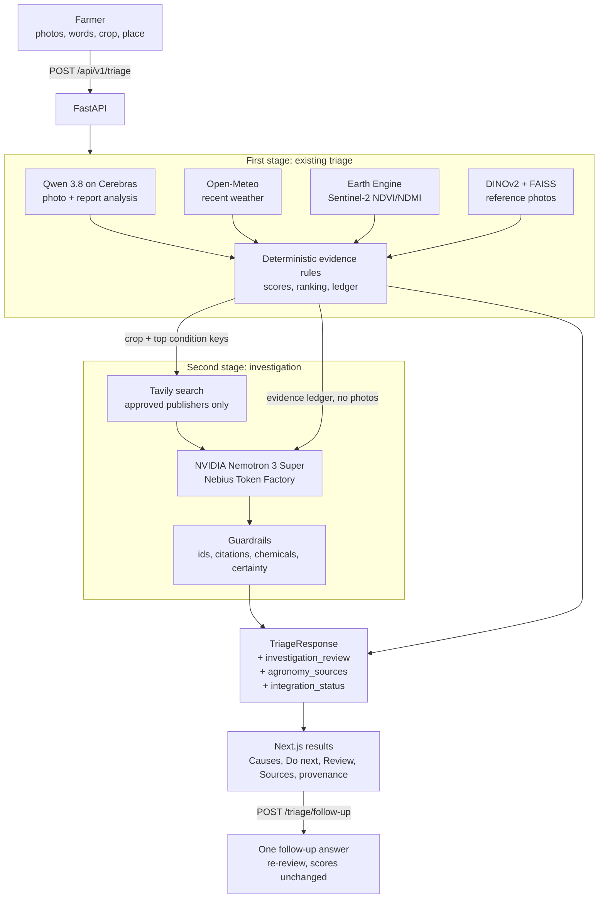

# Architecture

## Overview

The second stage only adds fields. It cannot change scores, ranking, urgency or actions, and any
failure returns the first-stage triage with an explicit status. Gemini is not used in this
codebase.

## Frontend (`apps/web`)

| Path | Purpose |
| --- | --- |
| `src/app/` | `/` landing, `/auth` sign in/up (with skip); `(app)/` group: `/report` wizard, `/results` |
| `src/components/brand/` | Logo, `[ BRACKET ]` links, pill buttons, botanical line art |
| `src/components/motion/` | Motion (Framer Motion) config and reveal/stagger primitives; respects reduced motion |
| `src/components/visuals/` | Three.js crop-row hero, lazy-loaded, paused offscreen |
| `src/components/farmer/` | 5-step report wizard (crop, photos, symptoms, location, review) |
| `src/components/triage/` | Result sections: urgency hero, actions, causes, evidence, gaps, sources |
| `src/components/auth/`, `app/` | Auth form; app header with profile chip |
| `src/components/ui/` | Remaining shadcn primitives (spinner, skeleton) |
| `src/lib/api/client.ts` | Typed API client; maps failures to `ApiError` (`network`, `timeout`, `validation`, `server`) |
| `src/lib/schemas/report.ts` | Zod schema for the form (mirrors server validation for fast feedback) |
| `src/types/triage.ts` | TypeScript mirror of the API contract |
| `src/hooks/` | Geolocation (~1 km), latest-result and local profile stores |

The form posts directly from the browser to the API. On success the result is stored in
`sessionStorage` and `/results` renders it. There is no persistence in Milestone 0.

Accounts are a UI preview only: no auth backend exists yet. Sign in/up and "skip" store a
display name/email (never a password) in `localStorage`.

## Backend (`apps/api`)

| Path | Purpose |
| --- | --- |
| `app/main.py` | `create_app()` factory: CORS, size-limit middleware, error handlers, routers |
| `app/core/config.py` | `Settings` from `ROOTCAUSE_*` environment variables |
| `app/core/errors.py` | `AppError` and handlers producing the standard error envelope |
| `app/core/middleware.py` | Rejects oversized requests by `Content-Length` before parsing |
| `app/api/routes/` | `health`, `triage` route handlers (thin: parse, validate, delegate) |
| `app/api/deps.py` | Dependency providers (`get_settings`, `get_triage_service`) |
| `app/schemas/` | Pydantic API contract (`triage.py`, `errors.py`, `health.py`) |
| `app/models/report.py` | Internal `FarmerReport` / `ReportImage`; sensitive fields hidden from `repr` |
| `app/services/image_validation.py` | Count, size and magic-byte type checks |
| `app/services/triage/` | `TriageService` protocol, `AiTriageService` (Cerebras), `MockTriageService`, translation, and `references.py` (reference-photo votes for evidence-fit scores) |
| `app/services/retrieval/` | Crop reference retrieval: dataset registry, DINOv2 embeddings, per-crop FAISS indexes ([retrieval.md](retrieval.md)) |
| `app/services/transcription.py` | Optional voice input: audio/language validation and `POST /transcribe` (Speech-to-Text V2 Chirp 3 via `app/integrations/google_speech.py`) |
| `app/integrations/nebius.py`, `tavily.py` | NVIDIA Nemotron (Nebius Token Factory, OpenAI-compatible) and Tavily Search/Extract clients with classified errors |
| `app/services/knowledge/` | Approved-publisher allowlist, crop/condition vocabularies, text safety checks, guidance search with validation and cache |
| `app/services/investigation/` | Nemotron reviewer, deterministic guardrails, orchestrator (wraps the triage service), follow-up service, in-memory state |
| `app/core/rate_limit.py` | Per-client hourly cap on model-backed endpoints |
| `scripts/` | Offline tooling: dataset preparation, model fetch, index build, evaluation; `smoke_live.py` for live Nebius/Tavily checks |
| `app/integrations/` | External adapters: Cerebras, Open-Meteo, Earth Engine, Speech-to-Text, Nebius, Tavily |

### Extension points

- **New analysis engine**: implement `TriageService.assess(report) -> TriageResponse` and return
  it from `get_triage_service()`. Route handlers do not change.
- **External evidence**: each adapter in `app/integrations/` returns typed results; the
  orchestrator converts them to `Evidence` items with real timestamps and `DataSource` entries.
  Unavailable sources are reported as `unavailable`, never silently skipped or assumed normal.
- **Tests** override dependencies via `app.dependency_overrides`.

## Cross-cutting rules

- **Facts vs hypotheses**: `evidence[]` holds observations only; `possible_causes[]` holds
  hypotheses with confidence and explicit uncertainty.
- **Privacy**: logs contain report ID, crop, image count and mode only. Validation errors return
  field names and messages, never submitted values. Photos are held in memory for the request
  only.
- **Uploads**: 1–3 images, JPEG/PNG/WebP detected from file bytes (client content type ignored),
  5 MB each by default, plus a total request cap.
- **Secrets**: server-side environment variables only; nothing secret uses the `NEXT_PUBLIC_`
  prefix.
